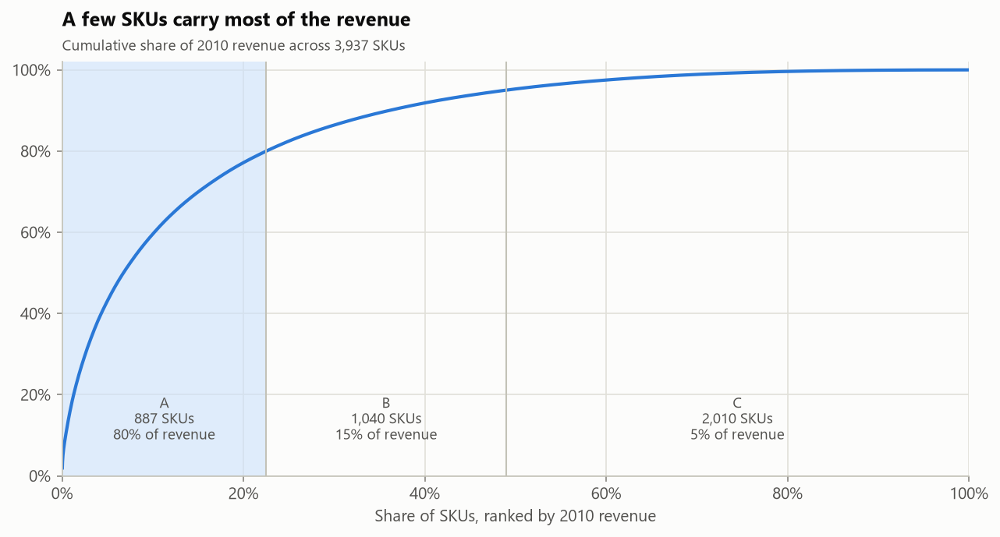
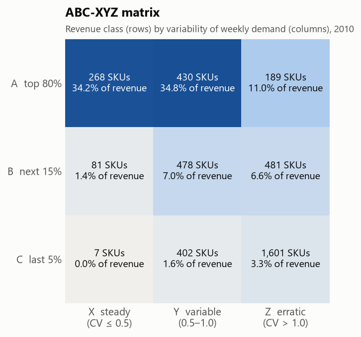
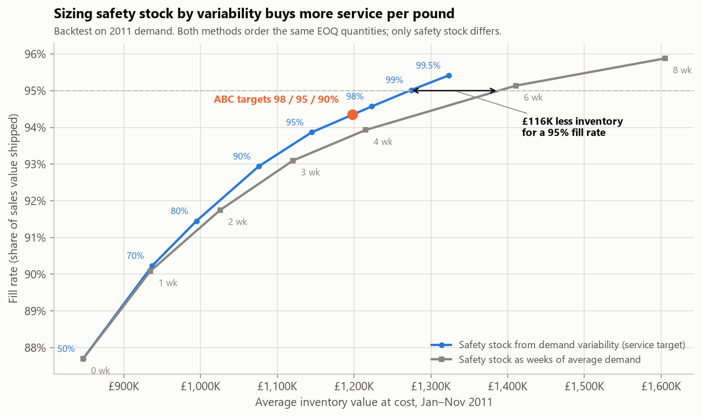
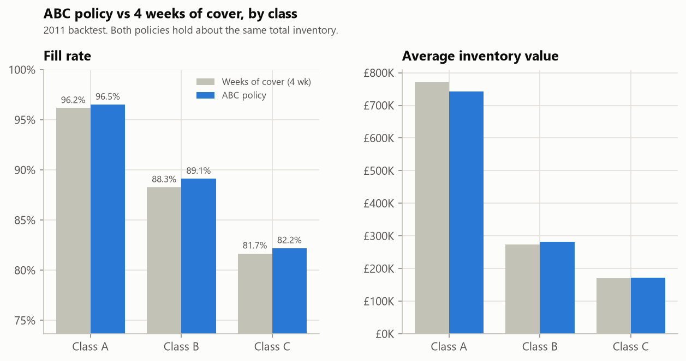
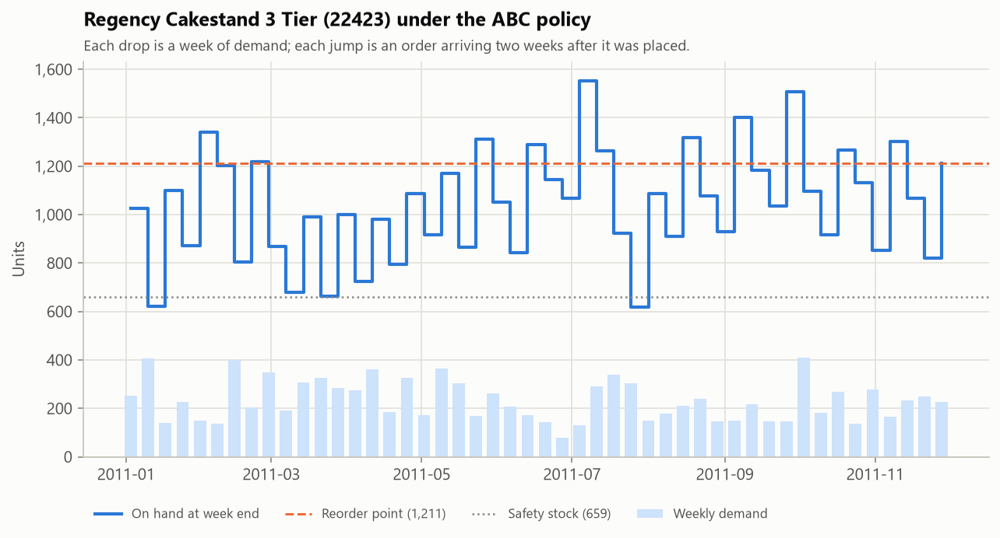

# Inventory Replenishment Planner
**Author:** Nana Afari  
**Tools:** Python (pandas, NumPy, matplotlib, openpyxl) · Excel (NORM.S.INV, XLOOKUP, SUMIFS, COUNTIFS, named ranges, conditional formatting)  
**Data:** [UCI Online Retail II](https://archive.ics.uci.edu/dataset/502/online+retail+ii): 1,067,371 real transactions from a UK online gift wholesaler, December 2009 to December 2011

---

## Project Overview
For every SKU, a replenishment analyst has to decide how much safety stock to hold, when to reorder and how much to order. This project builds that workflow on real sales data:

1. **Clean the transactions**: remove cancellations and the orders they reversed, postage and fee lines, and duplicates.
2. **Segment 3,937 SKUs** by revenue (ABC) and by how variable their weekly demand is (XYZ).
3. **Set a reorder policy for each SKU**: safety stock sized from demand variability and an ABC service target, a reorder point, and an economic order quantity (EOQ).
4. **Backtest the policy** week by week against 2011 demand it never saw, and compare it with a common rule of thumb: the same weeks of safety cover for every SKU.
5. **Package it in Excel** as a formula-driven policy calculator. Change the lead time or a service target and every SKU recalculates. Excel's results match Python for all 3,937 SKUs.

> **What's real and what's assumed.** The sales are real. The dataset has no supplier or cost data, so lead time (2 weeks), order cost (£25 per order line), holding cost (25% of unit cost per year) and unit cost (60% of the average selling price) are assumptions. They all live in `src/config.py` and on the workbook's Assumptions sheet.

---

## Key Findings
**Segmentation (2010)**
- **887 SKUs (23%) drive 80% of the £9.22M in revenue.** The bottom 2,010 SKUs (51%) share 5%.
- **Weekly demand is lumpy.** The median SKU's coefficient of variation is 2.2, because wholesale customers buy in bulk. With textbook XYZ cutoffs (0.5 and 1.0), 91% of SKUs would be "erratic", so I used 1.0 and 2.0 for weekly data. That gives 356 steady (X), 1,310 variable (Y) and 2,271 erratic (Z) SKUs.
- **268 A-class SKUs with steady demand carry 34% of revenue.** They are the easiest items to protect, and the most expensive to run out of.

**Policy backtest (January to November 2011, 3,068 SKUs sold in both years)**
- **Sizing safety stock from demand variability beats weeks of cover at every inventory level.** Reaching a 95% fill rate takes **£1.27M** of average inventory with the statistical method versus **£1.39M** with weeks of cover: **£116K (8%) less**. Both methods order the same EOQ quantities, so the difference comes only from how safety stock is set.
- **At about the same inventory (£1.20M vs £1.21M), the ABC policy ships 94.4% of demand vs 93.9%**, with 130 fewer stockout SKU-weeks (1,813 vs 1,943) and 9,286 fewer lost units.
- **Fill rate falls as demand gets lumpier**: 97.7% for steady X items, 94.7% for Y and 88.6% for erratic Z items. The normal-distribution safety stock formula understates lumpy demand, so erratic items need a different method (see Limitations).
- **Different targets by class didn't add efficiency.** Targets of 98% / 95% / 90% for A / B / C land on the same curve as a single target for every SKU. The gain came from sizing safety stock by variability, not from the class targets.
- **Demand for continuing SKUs fell 22% from 2010 to 2011** as the range turned over to new products. A policy set once a year drifts; reorder points should be refreshed at least quarterly.

**One SKU up close.** Regency Cakestand 3 Tier (22423) sells an average of 276 units a week (standard deviation 227). The policy holds 659 units of safety stock, reorders at 1,211 and orders 618 at a time. In 2011 it placed 18 orders and never ran out.

---

## Visuals
| ABC Pareto | ABC-XYZ matrix |
|---|---|
|  |  |



| Results by class | One SKU through 2011 |
|---|---|
|  |  |

---

## Excel Policy Calculator
`outputs/Inventory_Replenishment_Planner.xlsx`

| Sheet | What it does |
|---|---|
| Summary | Fill rate, stockouts, inventory value and cost for both policies, overall and by class (SUMIFS over the Backtest sheet). |
| Assumptions | Yellow input cells: lead time, order cost, holding rate, cost ratio, ABC and XYZ cutoffs, and service targets by class. Each is a named range. |
| SKU Policy | One row per SKU. Revenue share, ABC class, CV, XYZ class, service target (XLOOKUP), z-score (NORM.S.INV), safety stock, reorder point, EOQ and order quantity are all formulas. |
| ABC-XYZ | SKU counts and revenue shares by cell (COUNTIFS / SUMIFS over SKU Policy). |
| Backtest | 2011 results for each SKU under both policies. Fill rates under 90% are highlighted. |
| Trade-off | Fill rate and inventory for each service target and each weeks-of-cover setting, with a chart. |

`python run_pipeline.py --check` reads the workbook after Excel recalculates it and compares every SKU with Python. All five calculated fields match for all 3,937 SKUs: ABC class, XYZ class, safety stock, reorder point and order quantity.

---

## Method
**Cleaning.** 1,067,371 raw rows become 998,348 sales lines:

| Step | Rows left |
|---|---|
| Raw transactions | 1,067,371 |
| Remove cancellations and the sales they reversed (same customer, SKU and quantity within 30 days) | 1,042,703 |
| Remove zero or negative quantity or price | 1,036,498 |
| Remove postage, fees, manual adjustments and vouchers (anything that isn't a 5-digit product code) | 1,031,851 |
| Remove duplicate rows | 998,348 |

Matching cancellations to their original orders matters. One January 2011 order for 74,215 storage jars was cancelled the same day; left in, it would have looked like a year's demand in a single week.

**Calibration and test.** Weekly demand per SKU (Monday to Sunday weeks, zeros included) for the 52 weeks of 2010 sets the policy. The 48 weeks from January 3 to November 28, 2011 test it. December 2011 is excluded because the data ends on Friday, December 9.

**Classification.**
- ABC: rank SKUs by 2010 revenue. A = top 80% of cumulative revenue, B = next 15%, C = last 5%.
- XYZ: coefficient of variation (CV) of weekly demand = standard deviation / mean. X ≤ 1.0, Y ≤ 2.0, Z > 2.0.

**Policy (continuous review, reorder point s and order quantity Q).**
- Safety stock = z × weekly standard deviation × √(lead time), where z = NORM.S.INV(service target) and the target is 98% / 95% / 90% for A / B / C.
- Reorder point = average weekly demand × lead time + safety stock, rounded up.
- Order quantity = EOQ = √(2 × annual demand × order cost / (holding rate × unit cost)), rounded up, and at least one week of demand.
- Rule of thumb for comparison: safety stock = 4 weeks of average demand for every SKU, with the same order quantities. Four weeks holds about the same inventory as the ABC policy.

**Backtest.** Each week, orders due arrive, demand ships from stock (anything short is a lost sale), and if on-hand plus on-order stock is at or below the reorder point, the SKU orders enough multiples of Q to rise above it. Orders arrive two weeks later. Each SKU starts the year with safety stock plus one order on hand. Fill rate is weighted by sales value.

---

## Files
```
run_pipeline.py              runs everything; --check compares the workbook with Python
src/config.py                assumptions and cutoffs
src/data.py                  download, load and clean the transactions
src/classify.py              weekly demand, SKU statistics, ABC and XYZ
src/policy.py                safety stock, reorder point, EOQ; weeks-of-cover rule
src/simulate.py              week-by-week backtest
src/charts.py                README charts
src/workbook.py              Excel calculator and the Excel-vs-Python check
scripts/excel_finalize.ps1   opens the workbook in Excel, recalculates and saves (Windows)
outputs/                     workbook, CSVs (SKU policy, backtest by SKU and class, trade-off), key_numbers.json
images/                      charts
```

## How to Run
```
python -m venv .venv
.venv\Scripts\activate
pip install -r requirements.txt
python run_pipeline.py                       # downloads the data on first run, about 1 minute
powershell -ExecutionPolicy Bypass -File scripts\excel_finalize.ps1
python run_pipeline.py --check
```
The raw data downloads from the UCI repository into `data/raw/` the first time (about 45 MB) and is cached in `data/processed/`.

---

## Limitations
- **Assumed costs and lead time.** One 2-week lead time for every SKU with no lead time variability, and a flat order and holding cost. Real supplier data would change the reorder points.
- **Lumpy demand.** The normal-distribution formula is a poor fit for erratic Z items, which miss their targets most. Next steps: a method built for intermittent demand (Croston's method or bootstrapped lead-time demand), or planning Z items to order.
- **Static policy.** Parameters are set once from 2010 and never updated, with no seasonal adjustment for the Q4 peak. Refreshing monthly would track the 22% demand drop and the holiday build.
- **Demand is recorded sales.** Sales the retailer lost to its own stockouts aren't in the data, so true demand is understated. The backtest assumes lost sales, not backorders.
- **No ordering constraints.** Minimum order quantities, case packs, supplier schedules and budget limits are not modeled.

**Data citation:** Chen, D. (2012). Online Retail II [Dataset]. UCI Machine Learning Repository. https://doi.org/10.24432/C5CG6D. Licensed under CC BY 4.0.
